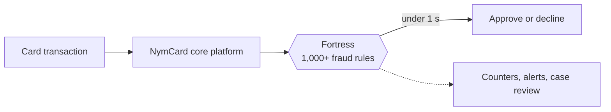
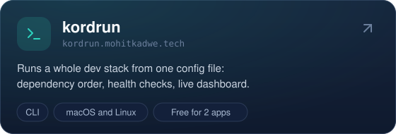
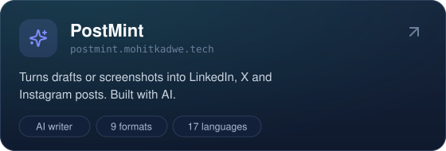
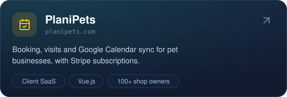
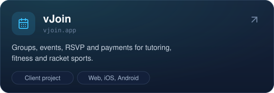

 

&nbsp;
&nbsp;

 

I build the parts of a card platform that must be fast and correct at the same time: fraud decisions, BNPL, bank integrations and identity checks. I work at **NymCard**, a card issuing and processing platform for banks and fintechs in the Middle East, with product, engineering and bank teams across **Dubai, Riyadh, the USA and Germany**.

## Teams I work with

## How a transaction flows through my work

## What I have built

| | What | Result |
|---|---|---|
|  | **Fortress**, real-time fraud detection (Python, FastAPI). Took it from MVP to production, replacing a third-party fraud PRM. | 1,000+ rules per transaction, under 1 s, about $10K in fraud blocked per month |
|  | **BNPL platform** for SAB and SNB (React, TypeScript, Node.js, Python, PostgreSQL), plus bank partner APIs | About 40% faster partner go-live |
|  | **Identity verification microservice** (Python, FastAPI, Azure OpenAI, Google Cloud Vision OCR) | 10,000+ checks a month, review time cut from 5 days to 5 minutes |
|  | **Platform work**: GitHub Actions CI/CD and PostgreSQL indexes | CI build time down 30 to 40%, index size down 50% |

## Products I ship on my own

  
  
  
  

## Career

## Ask me about

`fraud rule engines` · `BNPL and bank partner integrations` · `identity verification with LLMs and OCR` · `PostgreSQL index bloat` · `CI/CD speed-ups` · `working with teams across time zones` · `shipping a developer tool solo`

## Stack

## Recognition

- 🥇 **1st Place**, Rajasthan IT Day Hackathon 2023 (Physics Wallah and iNeuron.ai)
- 🏅 **National Finalist**, Smart India Hackathon 2022
- 🏅 **Finalist**, Microsoft Imagine Cup India 2021
- 🎓 **Mentored 100+ developers** through The 10x Academy, FunctionUp, PW Skills and Wiingy

## Work with me

| If you are | I can help with |
|---|---|
|  **A recruiter or hiring manager** | Senior backend or full-stack roles in fintech, payments and cards |
|  **An engineering lead** | Real-time risk and fraud systems, payment APIs, bank integrations |
|  **A founder** | Taking a product from idea to production, web and mobile |

Based in India (IST), working remotely with teams in Dubai, Riyadh, the USA and Germany. **The fastest way to reach me is a LinkedIn message.**

