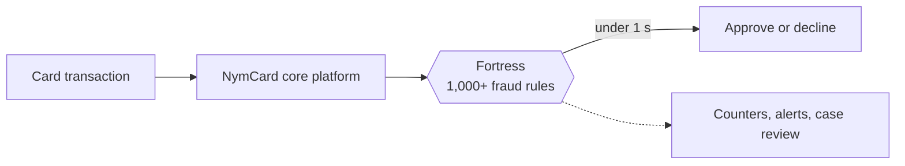
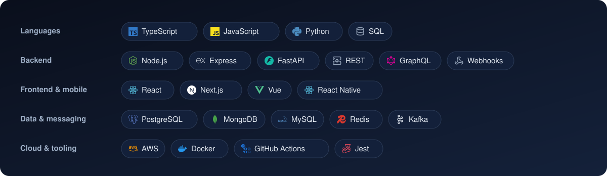
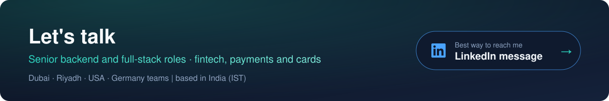

 

&nbsp;&nbsp;
&nbsp;&nbsp;
&nbsp;&nbsp;

 

**I build the parts of a card platform that must be fast and correct at the same time.** 
Fraud decisions · BNPL · bank integrations · identity checks

At **NymCard**, a card issuing and processing platform for banks and fintechs in the Middle East. 
Working with teams across Dubai, Riyadh, the USA and Germany.

 

## &nbsp; Teams I work with

## &nbsp; How a transaction flows through my work

## &nbsp; What I have built

| | Project | What I did | Result |
|:-:|---|---|---|
|  | **Fortress** | Real-time fraud detection in Python (FastAPI). Took it from MVP to production, replacing a third-party fraud PRM. | 1,000+ rules per transaction, under 1 s, about $10K fraud blocked a month |
|  | **BNPL platform** | Built for SAB and SNB with React, TypeScript, Node.js, Python and PostgreSQL, plus bank partner APIs. | About 40% faster partner go-live |
|  | **Identity verification** | Microservice in Python (FastAPI) with Azure OpenAI and Google Cloud Vision OCR. | 10,000+ checks a month, review from 5 days to 5 minutes |
|  | **Platform work** | GitHub Actions CI/CD and PostgreSQL index clean-up. | CI build time down 30 to 40%, index size down 50% |

## &nbsp; Products I ship

| | Product | What it does | Details |
|:-:|---|---|---|
|  | [**kordrun**](https://kordrun.mohitkadwe.tech) | Runs a whole dev stack from one config file: dependency order, health checks, unified logs, live dashboard. | CLI for macOS and Linux. Free for 2 apps. |
|  | [**PostMint**](https://postmint.mohitkadwe.tech) | Turns drafts or screenshots into LinkedIn, X and Instagram posts. | AI writer. 9 formats, 17 languages. |
|  | [**PlaniPets**](https://planipets.com) | Booking, visits and Google Calendar sync for pet businesses, with Stripe subscriptions. | Client SaaS, Vue.js. Used by 100+ shop owners. |
|  | [**vJoin**](https://vjoin.app) | Groups, events, RSVP and payments for tutoring, fitness and racket sports. | Client project. Web, iOS and Android. |

## &nbsp; Career

## &nbsp; Ask me about

| | Topic | What I can share |
|:-:|---|---|
|  | **Real-time fraud rule engines** | Running 1,000+ rules per transaction in under 1 second, and how Fortress went from MVP to production |
|  | **Identity verification with LLMs and OCR** | Azure OpenAI and Google Cloud Vision in production, and cutting review from 5 days to 5 minutes |
|  | **BNPL and bank integrations** | Working with SAB and SNB, and partner APIs that cut go-live time by about 40% |
|  | **PostgreSQL index bloat** | Cutting index size by 50% where indexes had grown larger than their tables |
|  | **CI/CD speed-ups** | 30 to 40% faster GitHub Actions builds with dependency caching and Docker build optimisation |
|  | **Working across time zones** | Daily work with teams in Dubai, Riyadh, the USA and Germany |
|  | **Shipping a developer tool solo** | kordrun: a CLI with an installer, license keys and a free tier |

## &nbsp; Stack

## &nbsp; Recognition

| | Award | Event |
|:-:|---|---|
|  | **1st Place** | Rajasthan IT Day Hackathon 2023 (Physics Wallah and iNeuron.ai) |
|  | **National Finalist** | Smart India Hackathon 2022 |
|  | **Finalist** | Microsoft Imagine Cup India 2021 |
|  | **Mentored 100+ developers** | The 10x Academy, FunctionUp, PW Skills and Wiingy |

## &nbsp; Work with me

| | If you are | I can help with |
|:-:|---|---|
|  | **A recruiter or hiring manager** | Senior backend or full-stack roles in fintech, payments and cards |
|  | **An engineering lead** | Real-time risk and fraud systems, payment APIs, bank integrations |
|  | **A founder** | Taking a product from idea to production, web and mobile |

